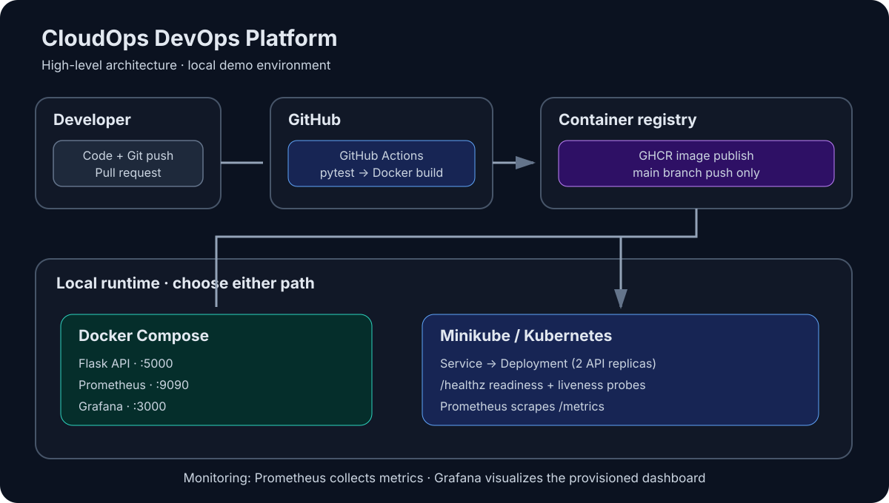
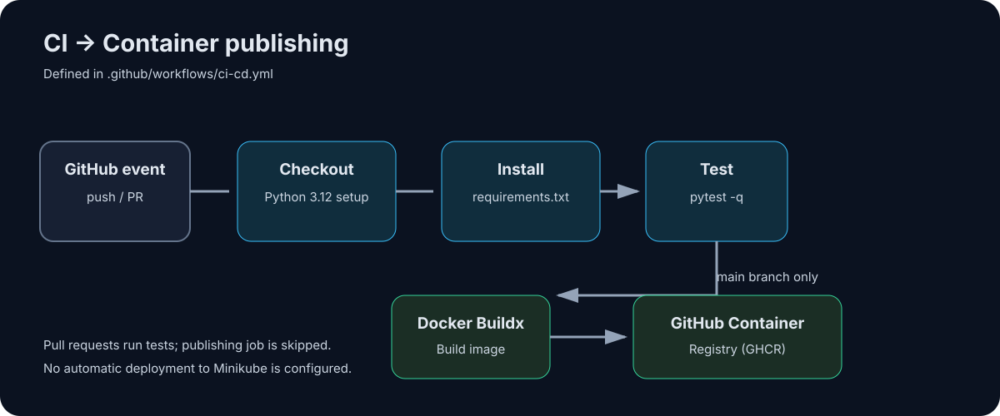
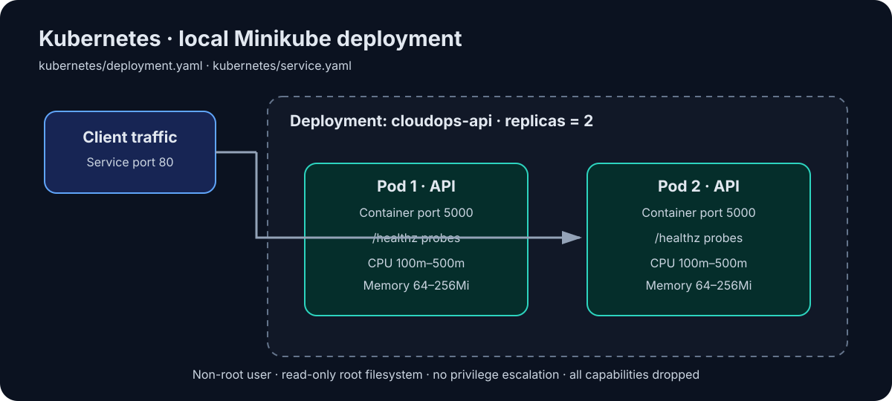
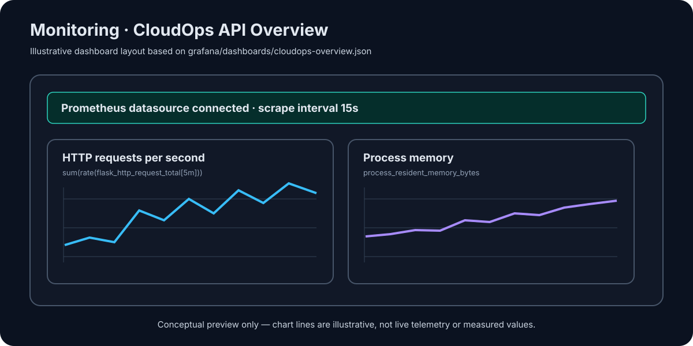

# CloudOps DevOps Platform

A portfolio project demonstrating a small Python service packaged with Docker, deployed to local Kubernetes, checked by GitHub Actions, and monitored with Prometheus and Grafana.

> **Scope:** This is a learning/demo environment. The Kubernetes manifests target a local Minikube cluster. The GitHub Actions workflow runs tests and builds/pushes a container image to GHCR when configured; it does not claim to deploy to a private local cluster from a GitHub-hosted runner.

## Architecture



The platform can run locally with Docker Compose or on a local Minikube cluster. Prometheus collects API metrics and Grafana displays the provisioned dashboard.

## Visual walkthrough

### CI and container publishing



### Kubernetes deployment



### Monitoring overview



> The monitoring graphic is a conceptual preview of the dashboard panels configured in this repository. Its chart lines are illustrative, not live telemetry.

## Repository layout

- `app/`: Flask API and tests
- `docker/`: container image definition
- `kubernetes/`: ConfigMap, Deployment and Service
- `monitoring/`: Prometheus scrape configuration
- `.github/workflows/`: CI and optional GHCR publishing
- `docs/`: architecture, deployment and troubleshooting notes

## Quick start: Docker Compose

Requirements: Docker Engine and Docker Compose plugin.

```bash
git clone https://github.com/NehaGill09/cloudops-devops-platform.git
cd cloudops-devops-platform
docker compose up --build
```

Then open:
- API: http://localhost:5000/
- Health: http://localhost:5000/healthz
- Metrics: http://localhost:5000/metrics
- Prometheus: http://localhost:9090/

Stop with `Ctrl+C`, then `docker compose down`.

## Run tests locally

```bash
python -m venv .venv
# Linux/macOS:
source .venv/bin/activate
# Windows PowerShell:
# .venv\Scripts\Activate.ps1
pip install -r app/requirements.txt
pytest -q app/tests
```

## Deploy to local Kubernetes (Minikube)

Requirements: kubectl and Minikube.

```bash
minikube start
kubectl apply -f kubernetes/configmap.yaml
kubectl apply -f kubernetes/deployment.yaml
kubectl apply -f kubernetes/service.yaml
kubectl rollout status deployment/cloudops-api
kubectl port-forward service/cloudops-api 5000:80
```

Visit http://localhost:5000/healthz. To inspect resources use `kubectl get pods,svc` and `kubectl describe deployment cloudops-api`.

The default manifest builds the image locally as `cloudops-api:1.0.0`. For Minikube, build into its Docker daemon before applying the Deployment:

```bash
eval "$(minikube docker-env)"
docker build -f docker/Dockerfile -t cloudops-api:1.0.0 .
```

On Windows PowerShell, use `minikube docker-env` instructions for your shell, or load an image with `minikube image load cloudops-api:1.0.0`.

## GitHub Actions and GHCR

The workflow runs on pushes and pull requests: installs dependencies, runs pytest, and builds the Docker image. On pushes to the default branch it can publish to GitHub Container Registry (GHCR). In the repository settings, ensure the workflow has **Packages: write** permission; the workflow requests this permission explicitly. The published package may need its visibility adjusted in GitHub Packages.

To deploy a GHCR image to a cluster, update `kubernetes/deployment.yaml` with the published image name and configure image pull access if the package is private. Do not commit registry passwords or Kubernetes secrets.

## Monitoring

Prometheus scrapes the Flask `/metrics` endpoint. With Docker Compose, open http://localhost:9090. Grafana is included in Docker Compose with a provisioned Prometheus datasource and a starter dashboard. Open http://localhost:3000/ and sign in with the local demo credentials shown above. Change the demo password before exposing Grafana beyond your machine.

Example PromQL:
- `http_requests_total`
- `rate(http_requests_total[5m])`
- `process_resident_memory_bytes`

## Security and operational notes

- The container runs as a non-root user.
- Kubernetes includes readiness/liveness probes and CPU/memory requests and limits.
- `SECRET_KEY` is supplied through an environment variable; the demo does not require a real secret.
- `secret-example.yaml` is a template only. Never commit real credentials.
- Add TLS, authentication, network policies, image scanning and managed secrets before any real production use.

## Learning outcomes

Docker image creation, container runtime basics, Linux command-line workflows, Kubernetes Deployments/Services/probes, automated testing, CI workflows, metrics collection, and operational documentation.

See [deployment guide](docs/deployment-guide.md), [architecture](docs/architecture.md), and [troubleshooting](docs/troubleshooting.md).
